# ambientCG: Paving Stones materials

**24 assets from [ambientCG](https://ambientcg.com), dedicated to the public domain under [CC0](https://docs.ambientcg.com/license/).** Use them in any game, free or paid, and change them however you like; no credit is needed.

PBR materials as 1K and 2K JPG maps (colour, normal GL and DX, roughness, AO, displacement), one folder per resolution. 880.3 MB in all.

This is a copy kept by [zuujis-cc0](https://github.com/zuujis-cc0) so game makers can take single files from GitHub. It is not made by or affiliated with ambientCG: the originals, often in more formats and higher resolutions, are on [ambientcg.com](https://ambientcg.com). If they help you, consider [supporting ambientCG](https://www.patreon.com/ambientCG).

Every file is listed in [MANIFEST.tsv](MANIFEST.tsv) with its size and SHA-256. More free assets: [the Zuujis collection](https://github.com/zuujis-cc0/free-game-assets#readme).

| | | | |
| :-: | :-: | :-: | :-: |
| <a href="PavingStones001">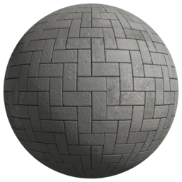</a> <b><a href="PavingStones001">Paving Stones 001</a></b> by ambientCG · <a href="https://ambientcg.com/a/PavingStones001">source</a> | <a href="PavingStones002">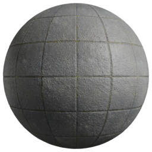</a> <b><a href="PavingStones002">Paving Stones 002</a></b> by ambientCG · <a href="https://ambientcg.com/a/PavingStones002">source</a> | <a href="PavingStones003">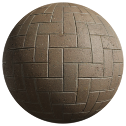</a> <b><a href="PavingStones003">Paving Stones 003</a></b> by ambientCG · <a href="https://ambientcg.com/a/PavingStones003">source</a> | <a href="PavingStones004">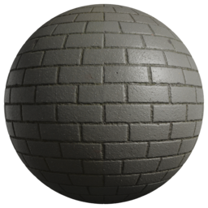</a> <b><a href="PavingStones004">Paving Stones 004</a></b> by ambientCG · <a href="https://ambientcg.com/a/PavingStones004">source</a> |
| <a href="PavingStones005">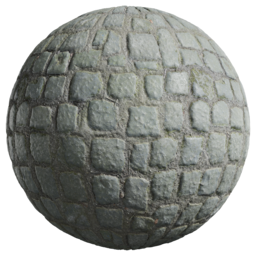</a> <b><a href="PavingStones005">Paving Stones 005</a></b> by ambientCG · <a href="https://ambientcg.com/a/PavingStones005">source</a> | <a href="PavingStones006">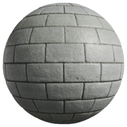</a> <b><a href="PavingStones006">Paving Stones 006</a></b> by ambientCG · <a href="https://ambientcg.com/a/PavingStones006">source</a> | <a href="PavingStones007">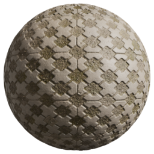</a> <b><a href="PavingStones007">Paving Stones 007</a></b> by ambientCG · <a href="https://ambientcg.com/a/PavingStones007">source</a> | <a href="PavingStones008">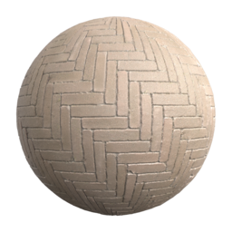</a> <b><a href="PavingStones008">Paving Stones 008</a></b> by ambientCG · <a href="https://ambientcg.com/a/PavingStones008">source</a> |
| <a href="PavingStones009">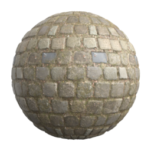</a> <b><a href="PavingStones009">Paving Stones 009</a></b> by ambientCG · <a href="https://ambientcg.com/a/PavingStones009">source</a> | <a href="PavingStones010">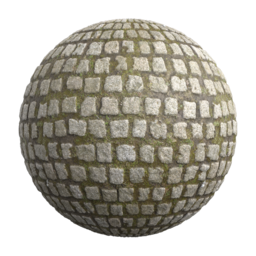</a> <b><a href="PavingStones010">Paving Stones 010</a></b> by ambientCG · <a href="https://ambientcg.com/a/PavingStones010">source</a> | <a href="PavingStones011">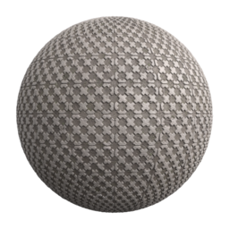</a> <b><a href="PavingStones011">Paving Stones 011</a></b> by ambientCG · <a href="https://ambientcg.com/a/PavingStones011">source</a> | <a href="PavingStones012">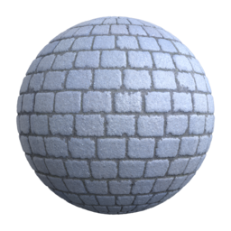</a> <b><a href="PavingStones012">Paving Stones 012</a></b> by ambientCG · <a href="https://ambientcg.com/a/PavingStones012">source</a> |
| <a href="PavingStones013">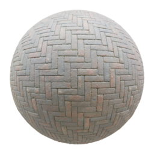</a> <b><a href="PavingStones013">Paving Stones 013</a></b> by ambientCG · <a href="https://ambientcg.com/a/PavingStones013">source</a> | <a href="PavingStones014">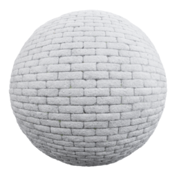</a> <b><a href="PavingStones014">Paving Stones 014</a></b> by ambientCG · <a href="https://ambientcg.com/a/PavingStones014">source</a> | <a href="PavingStones015">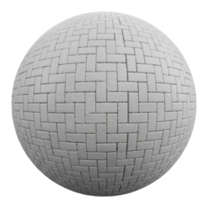</a> <b><a href="PavingStones015">Paving Stones 015</a></b> by ambientCG · <a href="https://ambientcg.com/a/PavingStones015">source</a> | <a href="PavingStones016">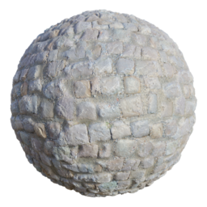</a> <b><a href="PavingStones016">Paving Stones 016</a></b> by ambientCG · <a href="https://ambientcg.com/a/PavingStones016">source</a> |
| <a href="PavingStones017">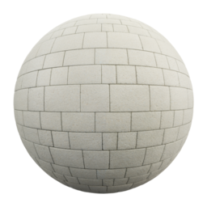</a> <b><a href="PavingStones017">Paving Stones 017</a></b> by ambientCG · <a href="https://ambientcg.com/a/PavingStones017">source</a> | <a href="PavingStones018">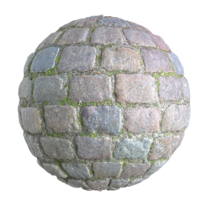</a> <b><a href="PavingStones018">Paving Stones 018</a></b> by ambientCG · <a href="https://ambientcg.com/a/PavingStones018">source</a> | <a href="PavingStones019">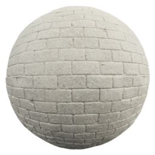</a> <b><a href="PavingStones019">Paving Stones 019</a></b> by ambientCG · <a href="https://ambientcg.com/a/PavingStones019">source</a> | <a href="PavingStones020">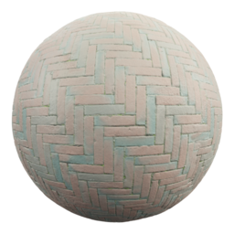</a> <b><a href="PavingStones020">Paving Stones 020</a></b> by ambientCG · <a href="https://ambientcg.com/a/PavingStones020">source</a> |
| <a href="PavingStones021">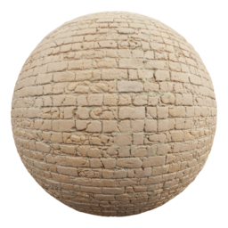</a> <b><a href="PavingStones021">Paving Stones 021</a></b> by ambientCG · <a href="https://ambientcg.com/a/PavingStones021">source</a> | <a href="PavingStones022">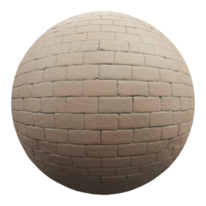</a> <b><a href="PavingStones022">Paving Stones 022</a></b> by ambientCG · <a href="https://ambientcg.com/a/PavingStones022">source</a> | <a href="PavingStones023">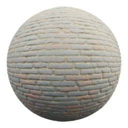</a> <b><a href="PavingStones023">Paving Stones 023</a></b> by ambientCG · <a href="https://ambientcg.com/a/PavingStones023">source</a> | <a href="PavingStones024">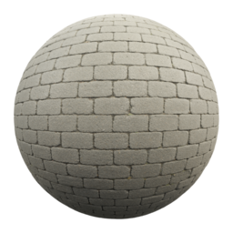</a> <b><a href="PavingStones024">Paving Stones 024</a></b> by ambientCG · <a href="https://ambientcg.com/a/PavingStones024">source</a> |

---

Kept up to date by this repository's own [update workflow](.github/workflows/update.yml), with code and plan from [cc0-mirror](https://github.com/zuujis-cc0/cc0-mirror). Something wrong? [Open an issue there](https://github.com/zuujis-cc0/cc0-mirror/issues/new) or use the [private report form](https://games.zuujis.com/report).
